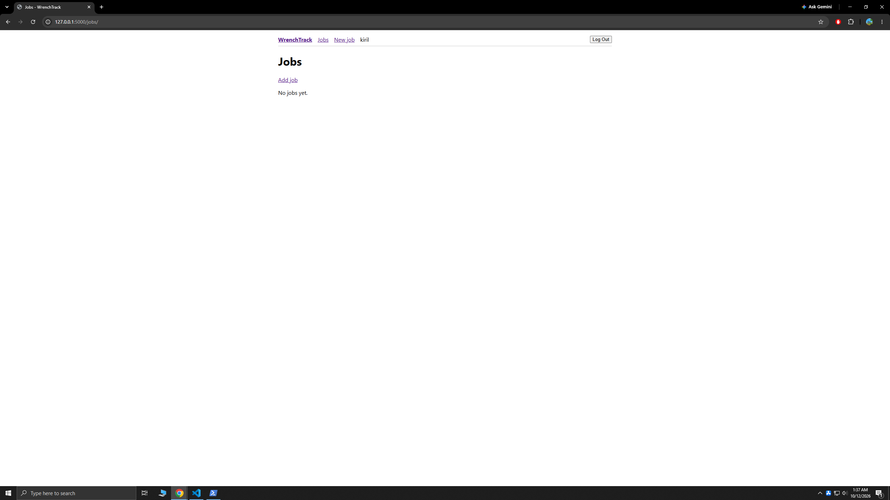
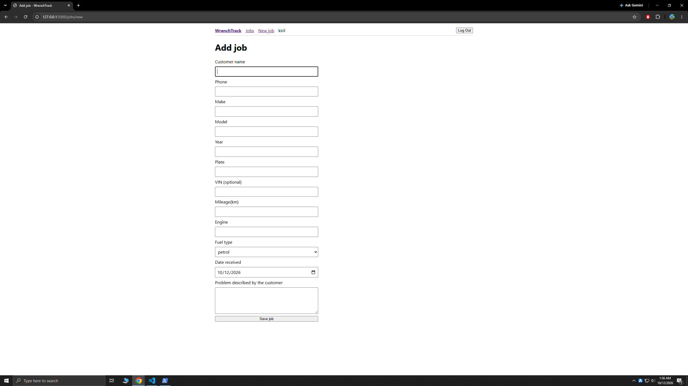
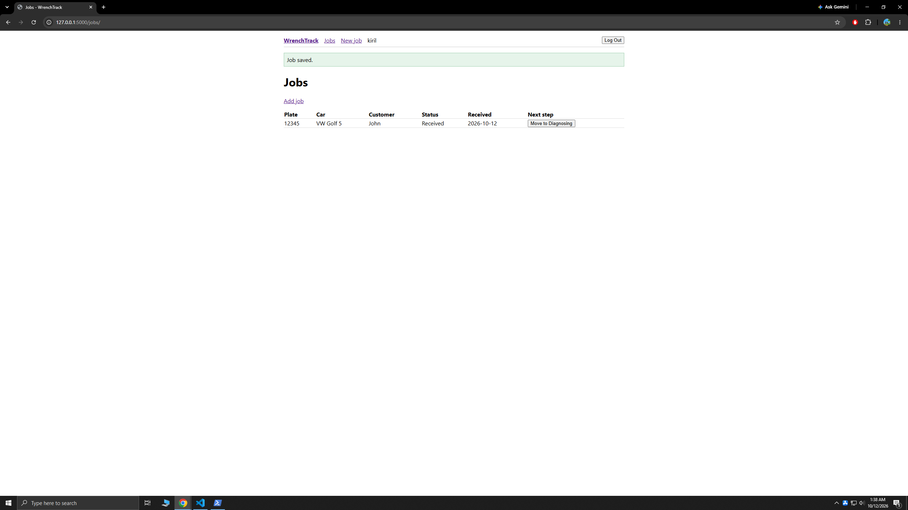

# WrenchTrack

A small web app for a car repair shop to track repair jobs, from the moment a car arrives until the customer picks it up. Built with Flask and SQLite. All data shown here is fake.

## Screenshots







## What it does

- Login and logout. There is no public sign-up page, users are created by an admin from the terminal.
- Every page requires login.
- Add a car with customer name, phone, make, model, year, plate, optional VIN, mileage, engine, fuel type and the problem described by the customer.
- Job list with colored status badges.
- One-click status flow: Received, Diagnosing, Waiting for parts, Repairing, Ready, Picked up.
- Job detail page with timestamped notes (times are UTC).

## Run it locally (Windows PowerShell)

```powershell
python -m venv .venv
.venv\Scripts\Activate.ps1
pip install -r requirements.txt
copy .env.example .env
```

Open `.env` and set `SECRET_KEY` to a long random value. You can generate one with:

```powershell
python -c "import secrets; print(secrets.token_hex(32))"
```

Create the database tables and a first user, then start the app:

```powershell
flask --app app init-db
flask --app app create-user YOUR_USERNAME
flask --app app run --debug
```

Open http://127.0.0.1:5000 and log in. To change a forgotten password:

```powershell
flask --app app reset-password YOUR_USERNAME
```

`init-db` deletes all existing data, so only run it on a fresh database.

## Security notes

- Passwords are hashed with Werkzeug (scrypt), never stored in plain text.
- The secret key comes from the environment, and the app refuses to start without it.
- All SQL uses parameter placeholders.
- Logout is POST only and the session cookie uses SameSite=Lax.
- CSRF tokens are not implemented yet (planned).

## Not built yet

- Edit a job after it is created
- Search and filter by plate, customer or status
- OBD fault codes per job (the database table exists)
- Parts and labor costs with a total
- Printable ticket, dashboard and CSV export
- Live deployment. A free host would reset the SQLite file on every restart, so this is a local demo for now.

## Stack

Python, Flask, SQLite, Jinja templates, plain HTML and CSS.